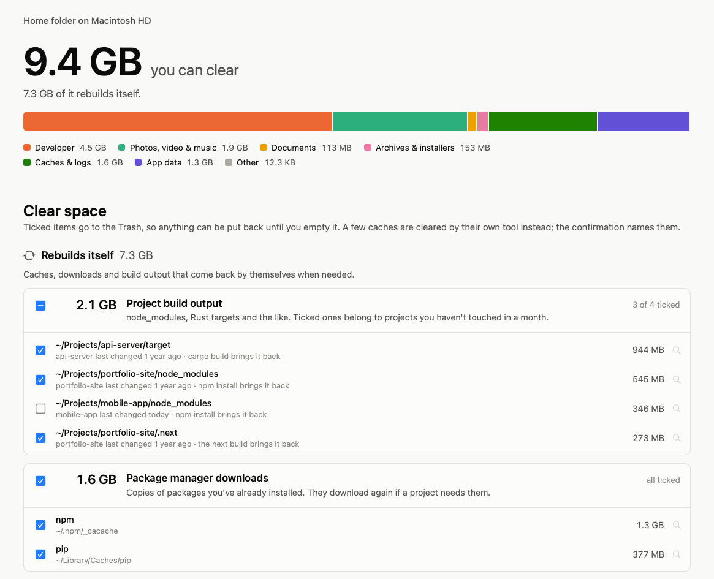
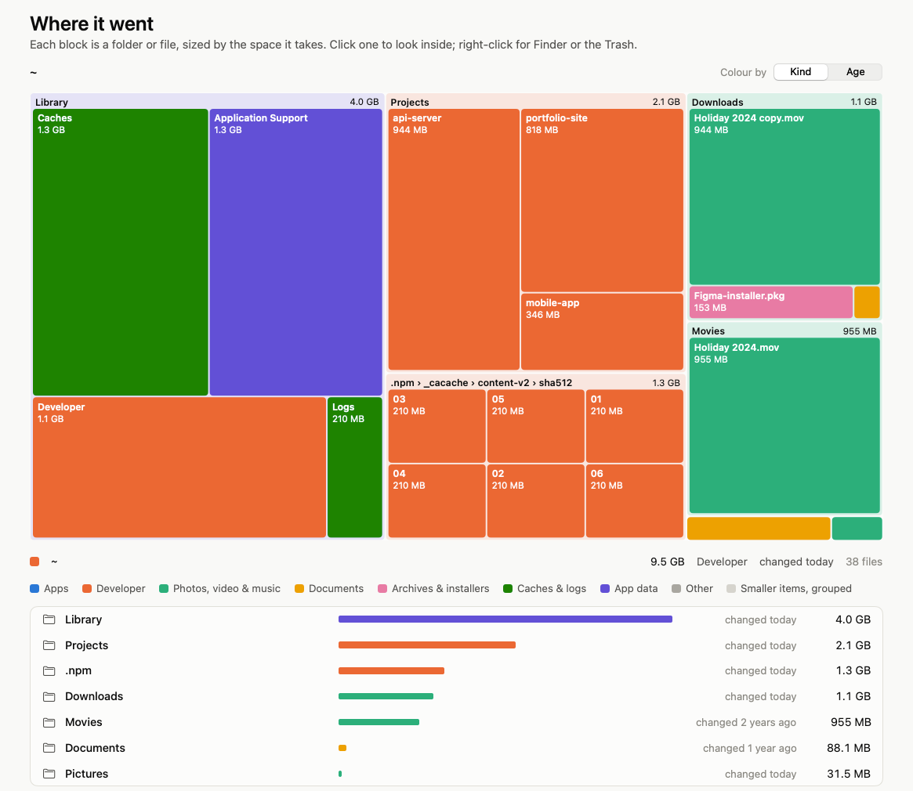

# Silt

A Mac app that shows where your disk space went and helps you clear what you don't need.

<picture>
  <source media="(prefers-color-scheme: dark)" srcset="docs/overview-dark.png">
  
</picture>

## What it does

- Scans your whole disk in about a minute and shows what's taking the space.
- Finds things you can clear: caches, old build output (`node_modules`, Rust `target`, Xcode data), package manager downloads, downloaded wallpapers, unused simulators, duplicates and more.
- Ticks only things that come back by themselves, plus installers that have sat in Downloads for over a month. Anything else that might be yours is listed, but left for you to decide.
- Shows a map of your disk that you can click into, coloured by kind or by age.

<picture>
  <source media="(prefers-color-scheme: dark)" srcset="docs/map-dark.png">
  
</picture>

## Is it safe?

- Clearing moves things to the Trash. You can put anything back until you empty it.
- A few caches are cleared by their own tool instead (Docker, Go). Silt tells you which before it runs them.
- It never removes your home folder or its standard folders, iCloud Drive, Photos, Mail, Messages, keychains, or anything inside an app.
- Clear never takes the last copy of a duplicated file. If you move one to the Trash by hand from the map, Silt warns you first.
- It warns you when a running app is using files you're about to clear, because the Trash can't fully empty while they're in use.

## Install

You need macOS 15 or later and Apple's Command Line Tools (`xcode-select --install`). Xcode itself isn't needed.

```sh
git clone https://github.com/dre4success/silt.git
cd silt
./build.sh --install
```

This builds Silt and puts it in `/Applications`.

To see your whole disk, give Silt **Full Disk Access** in System Settings › Privacy & Security. Without it, macOS hides some folders, and Silt tells you how much it couldn't see. Silt isn't signed with a developer certificate, so macOS may ask for access again after you rebuild it.

## Development

```sh
./test.sh                  # run the tests
.build/release/silt-scan   # the same scan in the terminal, read-only (built by ./build.sh)
```

The engine is in `Sources/SiltCore`, and the app is in `Sources/Silt`. The rules for what can be cleared are in `Rules.swift` and `Duplicates.swift`, each with a sentence saying why it's safe.

## License

MIT
